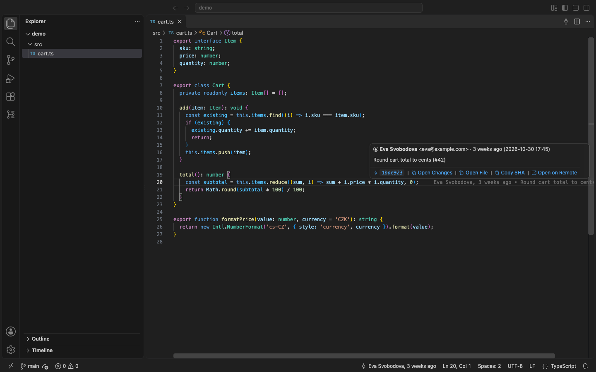

# Git Fate

See who changed every line, when and why, without leaving the editor.

Git Fate adds blame and history to VS Code: the author of the current line at the end of the line, a blame gutter for the whole file colored by age, and views with the history of a file or of the selected lines. It runs the `git` you already have and sends nothing anywhere.



## Features

### Current line blame

The line under the cursor shows its author, how long ago it changed and the commit message. Hover the annotation for the full message and quick actions:

- **Show commit**: files changed in the commit; pick one to see its diff
- **Open Changes**: diff of the file in that commit, scrolled to the line
- **Open File**: the file as it was at that revision
- **Copy SHA**, **Open on Remote** (GitHub, GitLab, Bitbucket, Azure DevOps)

The same blame sits in the status bar; click it to show the commit.

Unsaved edits are blamed too: changed lines show as _Uncommitted changes_.

### File blame with heatmap

`Alt+B` (or the person icon in the editor title) toggles blame for the whole file. Each block of lines shows the date and author of its last change. A bar on the left colors it by age: orange for recent changes, blue for old ones.


### File History and Line History

The Git Fate view in the activity bar has two lists:

- **File History**: every commit that changed the active file, following renames. Uncommitted changes come first.
- **Line History**: commits that changed the selected lines (`git log -L`). It follows the selection.

Click a commit to open its diff. Right-click for Open File at Revision, Show Commit Files, Open on Remote, Copy SHA and Copy Message.


## Commands

| Command                                | Default key |
| -------------------------------------- | ----------- |
| Git Fate: Toggle File Blame            | `Alt+B`     |
| Git Fate: Toggle Current Line Blame    |             |
| Git Fate: Show File History            |             |
| Git Fate: Show Line History            |             |
| Git Fate: Show Commit of Current Line  |             |
| Git Fate: Open Changes of Current Line |             |

The editor context menu has the line commands; the Explorer context menu has Show File History.

## Settings

| Setting                               | Default                          | Description                                                                   |
| ------------------------------------- | -------------------------------- | ----------------------------------------------------------------------------- |
| `gitFate.currentLine.enabled`         | `true`                           | Show blame of the current line at the end of the line.                        |
| `gitFate.currentLine.format`          | `${author}, ${ago} • ${message}` | Tokens: `${author}`, `${email}`, `${ago}`, `${date}`, `${message}`, `${sha}`. |
| `gitFate.statusBar.enabled`           | `true`                           | Show blame of the current line in the status bar.                             |
| `gitFate.fileBlame.heatmap`           | `true`                           | Color the file blame gutter by age.                                           |
| `gitFate.fileBlame.showInEditorTitle` | `true`                           | Show the Toggle File Blame button in the editor title.                        |
| `gitFate.dateFormat`                  | `relative`                       | `relative` (3 days ago) or `absolute` (2026-11-24 09:15).                     |
| `gitFate.history.limit`               | `200`                            | Most commits loaded into the history views.                                   |

Colors can be changed in `workbench.colorCustomizations`: `gitFate.inlineBlameForeground`, `gitFate.gutterForeground`, `gitFate.gutterBackground`.

Recent VS Code versions have their own blame in the status bar. To see only one, set `"git.blame.statusBarItem.enabled": false` or `"gitFate.statusBar.enabled": false`.

## Requirements

- VS Code 1.90 or newer
- `git` on your `PATH`, or set in VS Code's `git.path` setting

## Development

```bash
npm install
npm run build             # type check and bundle into dist/
npm run lint              # eslint and prettier
npm run test:unit         # parsers and git commands against a temporary repository
npm run test:integration  # the extension inside a downloaded VS Code
npm run package           # build a .vsix
```

Press `F5` in VS Code to start an Extension Development Host with the extension loaded.

## License

[MIT](LICENSE)
