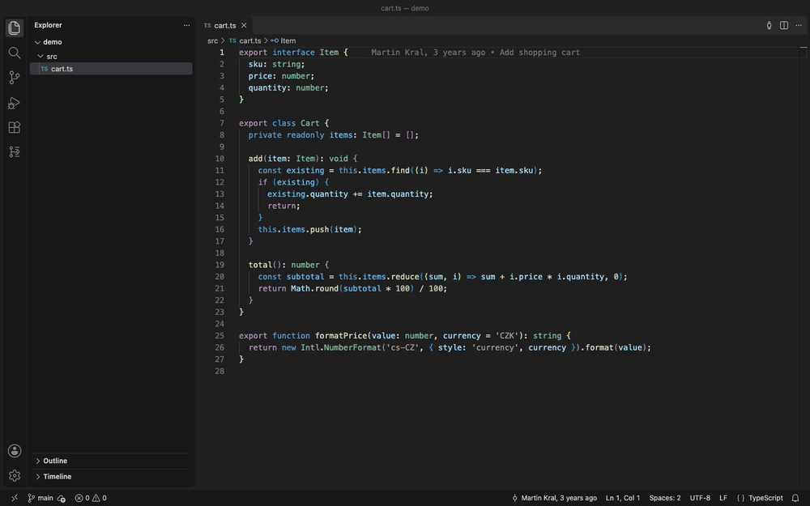
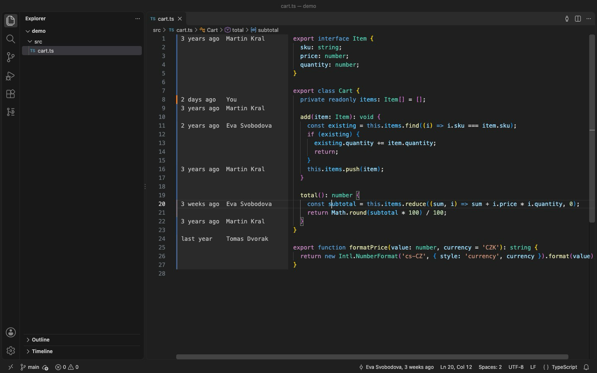
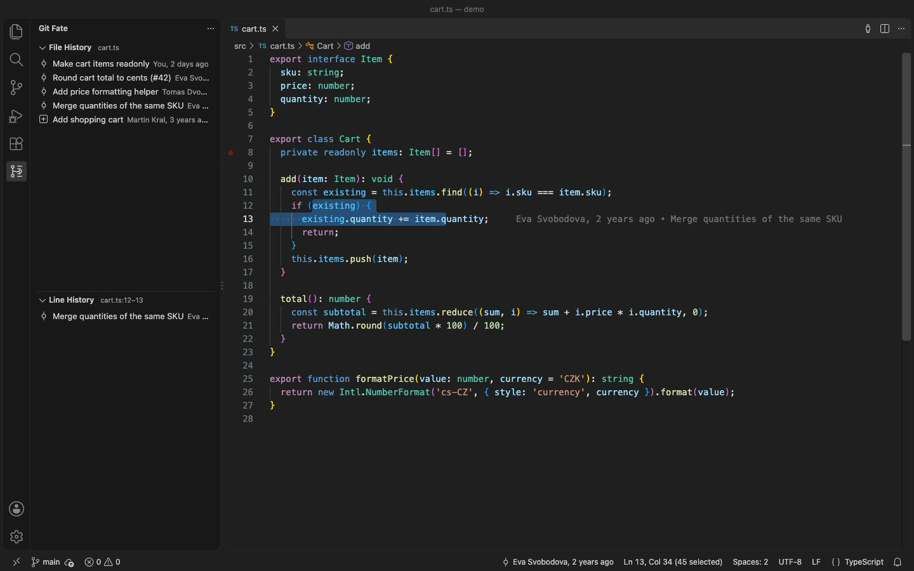
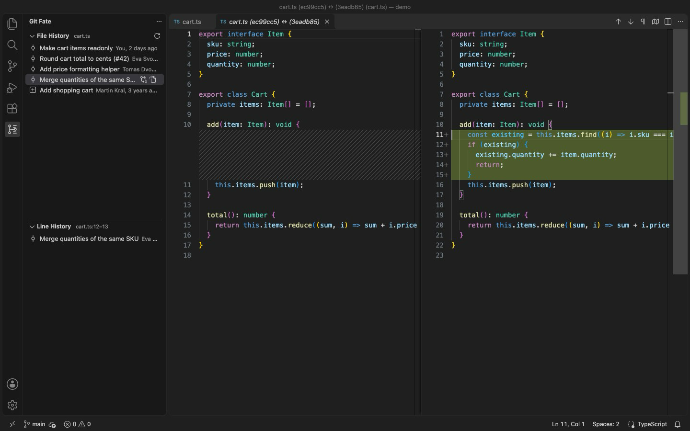

<p align="center">
  
</p>

<h1 align="center">Git Fate</h1>

<p align="center">
  <b>Every line of code has a story. Read it without leaving the editor.</b>
</p>

<p align="center">
  <a href="https://github.com/lipelix/git-fate/actions/workflows/ci.yml"></a>
  <a href="https://github.com/lipelix/git-fate/releases/latest"></a>
  
  <a href="LICENSE"></a>
</p>

<p align="center">
  
</p>

You land on a strange line. Who wrote it? When? Was it a quick fix or part of a bigger change? Git Fate answers in place: the author and commit of the line under your cursor, a heatmap of how old each part of the file is, and the full history of a file or of just the lines you selected. Every answer is one click away from the diff that explains it.

## Why Git Fate

- **Answers where you look.** Blame sits at the end of the current line. You don't open a panel, run a command or switch to a terminal.
- **The whole story, not just the last commit.** File History follows renames. Line History shows every commit that touched the lines you selected, even after they moved.
- **Light.** One 28 KB bundle with no runtime dependencies. Blame is cached per document version, and history loads only while its view is open.
- **Private.** It runs the `git` already on your machine. No account, no sign-in, no telemetry, no network calls.
- **Free, all of it.** MIT licensed. No paid tier, no feature behind a login.
- **Correct while you type.** Unsaved edits are blamed as _Uncommitted changes_, so an annotation never points at a commit that didn't write the line.

## Features

### Current line blame

Move the cursor and the line tells you who changed it, how long ago and why. Hover the annotation for the full commit message and actions:

| Action             | What it does                                                    |
| ------------------ | --------------------------------------------------------------- |
| **`abc1234`**      | Lists the files changed in the commit; pick one to see its diff |
| **Open Changes**   | Diff of this file in that commit, scrolled to your line         |
| **Open File**      | The file exactly as it was at that revision                     |
| **Copy SHA**       | Copies the full commit hash                                     |
| **Open on Remote** | Opens the commit on GitHub, GitLab, Bitbucket or Azure DevOps   |


The status bar shows the same blame. Click it to browse the commit.

### File blame with heatmap

Press `Alt+B`, or click the person icon in the editor title, to see blame for the whole file. Each block of lines shows the date and author of its last change. A colored bar shows its age: **orange** for fresh changes, **blue** for code that has not changed in years. Hot spots stand out at a glance.



### File History and Line History

The **Git Fate** view in the activity bar keeps two lists in sync with your editor:

- **File History**: every commit that changed the active file, across renames. Uncommitted changes come first.
- **Line History**: only the commits that changed the selected lines, powered by `git log -L`. Select a function and see how it evolved.

Click a commit to open its diff. Right-click it for Open File at Revision, Show Commit Files, Open on Remote, Copy SHA and Copy Message.



### Diffs that explain the change

Every commit opens as a side-by-side diff of the file before and after, with syntax highlighting and the parent revision on the left. Renamed files diff against their old name.



## Install

**From a release:** download `git-fate-<version>.vsix` from the [latest release](https://github.com/lipelix/git-fate/releases/latest), then:

```bash
code --install-extension git-fate-0.1.0.vsix
```

Or in VS Code: **Extensions** view → `...` menu → **Install from VSIX...**

**From source:**

```bash
git clone https://github.com/lipelix/git-fate.git
cd git-fate
npm install
npm run package
code --install-extension git-fate-0.1.0.vsix
```

Requires VS Code 1.90 or newer and `git` on your `PATH` (or set in VS Code's `git.path` setting).

## Commands

| Command                                | Key     |
| -------------------------------------- | ------- |
| Git Fate: Toggle File Blame            | `Alt+B` |
| Git Fate: Toggle Current Line Blame    |         |
| Git Fate: Show File History            |         |
| Git Fate: Show Line History            |         |
| Git Fate: Show Commit of Current Line  |         |
| Git Fate: Open Changes of Current Line |         |

The line commands are also in the editor's right-click menu. **Show File History** is in the Explorer's right-click menu.

## Settings

| Setting                               | Default                          | Description                                                                   |
| ------------------------------------- | -------------------------------- | ----------------------------------------------------------------------------- |
| `gitFate.currentLine.enabled`         | `true`                           | Show blame at the end of the current line.                                    |
| `gitFate.currentLine.format`          | `${author}, ${ago} • ${message}` | Tokens: `${author}`, `${email}`, `${ago}`, `${date}`, `${message}`, `${sha}`. |
| `gitFate.statusBar.enabled`           | `true`                           | Show blame of the current line in the status bar.                             |
| `gitFate.fileBlame.heatmap`           | `true`                           | Color the file blame by age.                                                  |
| `gitFate.fileBlame.showInEditorTitle` | `true`                           | Show the Toggle File Blame button in the editor title.                        |
| `gitFate.dateFormat`                  | `relative`                       | `relative` (3 days ago) or `absolute` (2026-11-24 09:15).                     |
| `gitFate.history.limit`               | `200`                            | Most commits loaded into each history view.                                   |

Colors are themable in `workbench.colorCustomizations`: `gitFate.inlineBlameForeground`, `gitFate.gutterForeground`, `gitFate.gutterBackground`.

## FAQ

**I see the author twice in the status bar.**
Recent VS Code versions have their own blame there. Keep one: set `"git.blame.statusBarItem.enabled": false` or `"gitFate.statusBar.enabled": false`.

**Why is a line I just typed shown as uncommitted?**
Git Fate blames what is in the editor, including unsaved changes. Lines that are not in any commit yet are labeled _Uncommitted changes_.

**Does it work with large files and long histories?**
Blame runs once per document version and is reused while you move around. The history views load on demand, up to `gitFate.history.limit` commits.

## Contributing

Issues and pull requests are welcome.

```bash
npm install
npm run build             # type check and bundle into dist/
npm run lint              # eslint and prettier
npm run test:unit         # parsers and git commands against a temporary repository
npm run test:integration  # the extension inside a downloaded VS Code
```

Press `F5` in VS Code to start an Extension Development Host. `scripts/demo-repo.sh <dir>` creates a small repository with several authors to try things on.

## License

[MIT](LICENSE)
